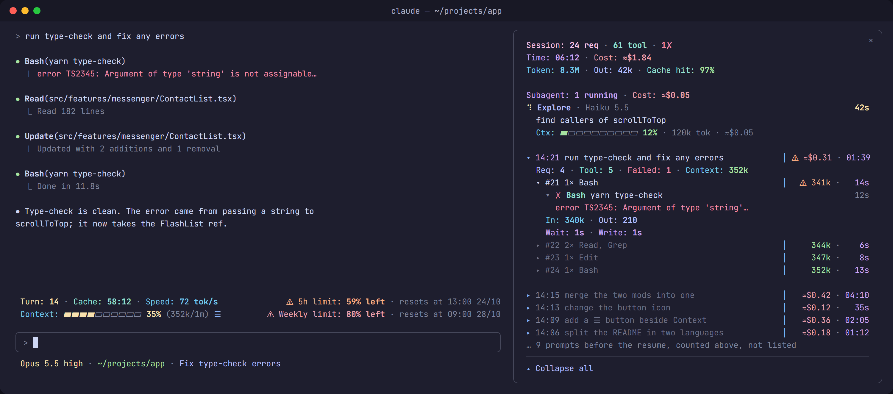

# session-band

[English](README.md) · Tiếng Việt

Mod Claude Code gồm hai phần, cộng một status line đi kèm:

- **Band** luôn nằm trên prompt: turn, thời gian còn lại của prompt cache, tốc độ output, context, giới hạn 5h và weekly.
- **Pane activity**, mở bằng nút `☰` cạnh Context: từng prompt, các request gửi lên model, tool call và subagent của chúng, cùng các shell còn đang chạy nền.
- **Status line** (`statusline.js`) dưới prompt: model và effort, thư mục, tên session. Nó cũng chuyển cho band những số liệu mà API của mod không có.



<sub>Ảnh minh hoạ dựng theo đúng những gì mod vẽ, không phải ảnh chụp: font và độ rộng thật theo terminal của bạn.</sub>

Giao diện của mod (band, pane, thông báo) viết bằng tiếng Anh; README này giải thích bằng tiếng Việt.

## Cài đặt

Cần Claude Code bản có mod (bật sẵn từ 2.1.287; mod được viết trên 2.1.310). Chạy được trên macOS, Linux và Windows.

### Một dòng

Band và pane activity, gõ ở prompt của một session trong terminal:

```text
/plugin install session-band --marketplace KhoaaTran/session-band
```

Trả lời `y` để thêm marketplace, rồi chọn scope (scope user đứng đầu). Từ shell: `claude plugin install session-band --marketplace KhoaaTran/session-band`. Trong app desktop: bấm + cạnh ô prompt, Plugins, Add marketplace với `KhoaaTran/session-band`, rồi Add plugin.

Status line, cache prompt 1 giờ và phím tắt mở pane không nằm trong plugin: muốn có chúng thì cài bằng prompt dưới đây, cách này cần thêm Node.js và git.

### Một prompt

Mở Claude Code ở thư mục bất kỳ rồi dán nguyên prompt này:

```text
Cài mod session-band cho Claude Code trên máy này, làm đúng các bước sau:

1. Clone https://github.com/KhoaaTran/session-band.git vào ~/.claude/mods/session-band. Nếu thư mục đã có repo này thì chạy git pull thay vì clone.
2. Chạy node --version. Nếu không có Node.js thì dừng lại và báo tôi.
3. Gộp vào ~/.claude/settings.json, giữ nguyên mọi cấu hình đang có (tạo file nếu chưa có). Đường dẫn là đường dẫn tuyệt đối của máy này, dùng dấu / kể cả trên Windows:
   - env.CLAUDE_CODE_PLUGIN_DIRS = đường dẫn tới thư mục mod. Nếu biến này đã có giá trị khác thì hỏi tôi trước khi đổi.
   - env.ENABLE_PROMPT_CACHING_1H = "1"
   - statusLine = { "type": "command", "command": "node <thư mục mod>/statusline.js", "refreshInterval": 1 }. Nếu đã có statusLine khác thì hỏi tôi trước khi thay.
4. Gộp vào ~/.claude/keybindings.json, giữ các binding đang có (tạo file nếu chưa có, với "$schema": "https://www.schemastore.org/claude-code-keybindings.json"): trong block context "Chat", thêm "ctrl+x ctrl+p": "command:activity". Nếu phím này đang gán việc khác thì hỏi tôi.
5. Chạy claude plugin validate ~/.claude/mods/session-band và báo kết quả.
6. Tóm tắt những gì đã đổi trong hai file cấu hình, rồi nhắc tôi mở session mới để mod được nạp.
```

### Cài tay

1. Clone repo vào `~/.claude/mods/session-band`.
2. Gộp vào `~/.claude/settings.json`, với `<home>` là đường dẫn tuyệt đối tới thư mục home: `/Users/you` trên macOS, `/home/you` trên Linux, `C:/Users/you` trên Windows:

   ```json
   {
     "env": {
       "CLAUDE_CODE_PLUGIN_DIRS": "<home>/.claude/mods/session-band",
       "ENABLE_PROMPT_CACHING_1H": "1"
     },
     "statusLine": {
       "type": "command",
       "command": "node <home>/.claude/mods/session-band/statusline.js",
       "refreshInterval": 1
     }
   }
   ```

3. Gộp vào `~/.claude/keybindings.json` phím mở pane:

   ```json
   {
     "bindings": [{ "context": "Chat", "bindings": { "ctrl+x ctrl+p": "command:activity" } }]
   }
   ```

4. Mở session mới. Band hiện trên prompt, `☰` cạnh Context mở pane, status line hiện model, thư mục và tên session. Không thấy band thì chạy `claude --debug` và tìm dòng nạp `session-band` trong debug log.

`ENABLE_PROMPT_CACHING_1H` cho prompt cache sống 1 giờ; thiếu nó cache chỉ sống 5 phút và band hiện `(5m, 1h off)`. `refreshInterval: 1` giữ đồng hồ cache của band khớp từng giây.

Cập nhật: `git pull` trong `~/.claude/mods/session-band`, rồi mở session mới.

### Thêm phần riêng vào status line

Muốn thêm phần riêng của máy mình vào cuối status line mà không sửa repo, tạo `~/.claude/statusline.local.js` export một hàm `(input, colors) => string`: `input` là JSON Claude Code đưa cho status line, `colors` là bảng màu của script. Không có file này thì status line chạy như thường.

```js
module.exports = (d, C) => (d.session_id ? C.teal + "◆ việc riêng" + C.r : "")
```

### Band đọc gì

| File | Dùng để |
|---|---|
| `claude-prompt-cache-<session id>.json` trong thư mục tạm của hệ điều hành | hạn thật của prompt cache, số turn |
| `~/.claude/rate-limits-cache.json` | giới hạn 5h/weekly mới nhất của mọi session |

`statusline.js` ghi ra cả hai. Thiếu chúng thì band vẫn chạy: hạn cache được ước tính từ câu trả lời gần nhất, và giới hạn lấy từ `$.session.usage()` của session đang chạy.

### Pane ghi gì

| Thư mục | Dùng để |
|---|---|
| `session-band/<session id>/` trong thư mục tạm chỉ bạn đọc được: `%TEMP%` trên Windows, `$TMPDIR` trên macOS, `$XDG_RUNTIME_DIR` (không có thì `~/.cache`) trên Linux | input và output đầy đủ của từng tool call, mỗi call một file JSON, prompt và báo cáo của từng subagent, cùng dấu `alive` mà session ghi lại mỗi phút |

Thư mục bị xoá khi session kết thúc (thoát, `/clear`, resume). Khi một session khởi động, nó xoá thư mục của các session đã kết thúc mà chưa tự xoá được, kể cả session bị tắt ngang, và để yên thư mục mà một session khác vẫn đang ghi dấu. State của session chỉ giữ vài dòng đầu của mỗi call.

| Store | Dùng để |
|---|---|
| `totals:<session id>` trong `$.store` riêng của mod (một file JSON trong `~/.claude`) | chỉ các số ở dòng Session, khoảng chục con số, lưu sau mỗi câu trả lời và khi session kết thúc; giữ 50 session gần nhất |

Khi resume, pane tính tiếp từ các số đó: dòng Session, Time, Cost và Token cộng cả phần trước, còn các prompt trước lúc resume chỉ hiện thành một dòng đếm, `… 9 prompts before the resume`. Dòng prompt, request và tool call của chúng không được giữ.

### Mọi thứ mod chạy, đọc và gửi

Không có gì đi qua mạng: cả mod lẫn `statusline.js` đều không gửi dữ liệu đi đâu, không tải gì về, và không đổi setting hay quyền nào.

| | Mod (`hooks/`) | `statusline.js` (chỉ khi cài đầy đủ) |
|---|---|---|
| Theo dõi | prompt, request, tool call và subagent của session để vẽ lên pane; nội dung của chúng chỉ nằm trên máy này, trong các file ở trên | JSON mà Claude Code đưa cho status line |
| Đọc | các biến môi trường `HOME`, `USERPROFILE`, `OS`, `TEMP`, `TMP`, `TMPDIR` và `XDG_RUNTIME_DIR`, để tìm thư mục tạm và thư mục home; hai file ở mục Band đọc gì; thư mục riêng và `$.store` của nó; số liệu usage của session | transcript của session, để lấy tiêu đề và số turn; `~/.claude/statusline.local.js` nếu bạn có tạo |
| Ghi | thư mục riêng và `$.store` của nó, như ở trên | `claude-statusline-<session id>.json` và `claude-prompt-cache-<session id>.json` trong thư mục temp của hệ thống, `~/.claude/rate-limits-cache.json` |
| Chạy | một lệnh, để xoá thư mục của chính nó cho một session: `cmd /c rmdir /s /q <folder>` trên Windows, `rm -rf -- <folder>` trên macOS và Linux, chỉ với thư mục `session-band/<session id>` trong thư mục tạm | không có |
| Gọi | tool `PushNotification` của Claude Code khi cache prompt còn 10 rồi 5 phút là hết hạn và Claude đang không làm gì: `<thư mục project>: the prompt cache expires in 5 min`, hiện trên máy tính và, qua Remote Control, trên điện thoại; không gửi được thì hiện toast | không có |

Mod không ghi file build, khởi động, setting hay instructions nào: mọi lần ghi đều vào thư mục riêng `session-band/<session id>/` trong thư mục tạm, hoặc vào `$.store` riêng của nó. Nó không tải gì về. Chương trình duy nhất nó chạy là lệnh xoá thư mục ở trên, lệnh đó không gửi gì đi.

#### Các hook của mod

Mọi hook đều để nguyên những gì nó thấy; mod chỉ ghi lại và vẽ.

| Sự kiện | Hook làm gì |
|---|---|
| `session.start` | đăng ký `/activity` và `/session-band`, chạy đồng hồ một giây của pane, xoá thư mục của các session đã kết thúc |
| `session.end` | lưu các số của dòng Session, xoá thư mục của session này; khi `/clear` hay resume thì làm trống pane |
| `prompt.submit` | đọc notification của task nền, để kết thúc dòng shell mà nó nhắc tới |
| `turn.start`, `turn.step`, `turn.complete` | ghi lại từng prompt, request (token, thời gian, model, effort) và câu trả lời, của main loop và của subagent |
| `tool.call` | ghi lại từng tool call, input và output của nó, vào thư mục của session |
| `agent.spawn` | ghi lại từng subagent: loại, mô tả, model và prompt nó nhận |
| `command.run` | chỉ trả lời `/activity` và `/session-band` của chính nó, qua matcher |
| `ui.render` | vẽ band trên prompt và pane activity |
| `ui.close` | ghi nhận pane đã đóng, cho nút trên band |

## Dùng

| Việc | Cách |
|---|---|
| Mở/đóng pane | bấm `☰` cạnh Context (xanh lá khi đang mở), hoặc `/activity` |
| Phím tắt | `Ctrl+X Ctrl+P` từ ô nhập prompt (gán lúc cài) |
| Đi vào pane bằng bàn phím | `Ctrl+X Tab`, rồi Tab/Enter; `Ctrl+X X` để đóng |
| Nới/thu pane | kéo mép pane, hoặc `Ctrl+X ←`/`Ctrl+X →` khi đang ở trong pane |
| Xem đầy đủ một tool call | bấm vào dòng của nó; `‹ Back` để quay lại đúng dòng đó |
| Xoá lịch sử đã xong | `/activity clear`; `/clear` cho pane bắt đầu lại cùng hội thoại mới; resume thì tính tiếp từ số của session |
| Thử thông báo cache sắp hết | `/session-band demo <phút>` |

Bấm vào nút trong band không ghi gì vào transcript. Chạy `/activity` (kể cả qua phím tắt) để lại một dòng lệnh, khoảng chục token.

### Ví dụ

- **Quay lại sau một lúc nghỉ, trước prompt tiếp theo**: đồng hồ của band cho biết cache prompt còn hạn không, và `Cache tax` dưới các dòng Session của pane cho biết request tiếp theo trả bao nhiêu để gửi lại context, khi cache còn hạn hay đã hết.
- **Vì sao một prompt tốn chừng đó**: bấm vào dòng của nó. Các request cho thấy context mỗi lần gửi và thời gian, các tool call cho thấy cái gì đã chạy; `⚠` đánh dấu tool lỗi hay cache bị ghi lại.
- **Subagent được giao gì và trả lời gì**: bấm vào dòng của nó trong mục Subagent. Các request và tool call của nó, rồi nguyên văn prompt nó nhận và báo cáo nó trả về.
- **Xem đầy đủ output của một tool call mà transcript đã thu gọn**: bấm vào dòng của call đó; `‹ Back` quay lại.

## Đọc số liệu trong pane

| Chỗ | Ý nghĩa |
|---|---|
| Dòng Session ở đầu pane | số request, tool call và lỗi; thời gian và chi phí; `Token`: mọi token API đã xử lý, gồm input (kể cả đọc từ cache) và output, tính cả subagent (mỗi request gửi lại cả hội thoại nên số này lớn hơn context nhiều) · `Out`: token model sinh ra · `Cache hit`: tỉ lệ input của main loop đọc từ cache |
| `Background: 1 running` | nằm dưới dòng Session khi có shell chạy nền (`run_in_background`, ctrl+b, quá timeout): mỗi lệnh một dòng, đếm giờ tới khi task kết thúc, bất kể prompt nào khởi động nó |
| `│` | chia đôi dòng: tên bên trái, số liệu canh phải bên phải |
| Thời gian | dưới 1 phút viết bằng giây (`14s`), từ 1 phút viết dạng đồng hồ (`01:39`, `1:02:40`); cột bên phải đệm cho cùng độ rộng để thẳng hàng |
| Dòng prompt, bên trái | giờ gửi (`14:21`, sáng màu khi prompt đang mở hoặc đang chạy), rồi nội dung prompt; lượt do notification của task nền mở ra thì hiện phần tóm tắt (`Background command "…" completed (exit code 0)`); khi danh sách vắt qua nửa đêm, một dòng kẻ ghi ngày (`── 24/10 ──`) |
| Dòng prompt, bên phải | chi phí của prompt, gồm cả subagent · tổng thời gian; context sau prompt nằm ở dòng tóm tắt |
| `Turn` | số thứ tự lượt của main loop trong session, tính cả các lượt trước khi resume |
| `Cache tax` · `expired` | tiền một request phải trả để gửi lại context nếu tiếp tục task: khi cache còn hạn thì đọc từ cache (giá đọc) · khi cache hết hạn thì ghi lại vào cache (giá ghi). Một dòng chung dưới ba dòng Session, tính theo context hiện tại của main |
| `Model` | model và effort mà request đó được gửi đi |
| Dòng request (`#n`), bên phải | context sau request đó · thời gian từ lúc gửi request tới khi tool cuối xong |
| Dòng tool, bên phải | thời gian tool chạy, với shell chạy nền thì tính tới khi task kết thúc; màu cam khi từ 30s trở lên |
| `In` / `Out` | token input (gồm cache) / token model sinh ra, lấy từ API |
| `Wait` / `Write` | từ lúc gửi tới phần đầu tiên của response về / từ đó tới hết response; `Time` khi không thấy phần nào của response |
| `⚠` | có chuyện cần xem: tool lỗi, request lỗi, cache bị ghi lại, prompt bị dừng |
| `⚠ cache written again 365k` | cache đã hết hạn nên request ghi lại cả context (ghi từ 20k token và ít nhất nửa input) |
| `Cost` | ước tính theo bảng giá trong `hooks/register.tsx`, đã gồm subagent; engine chỉ báo token chứ không báo tiền |

Tool chạy song song với lúc model đang viết câu trả lời, nên thời gian của request không bằng `Wait + Write` cộng thời gian các tool.

Dòng `Agent` mở ra được, hiện context, chi phí và các tool call của subagent mà nó tạo. Mỗi dòng subagent trong mục `Subagent`, đang chạy hay đã xong, ghi loại, model · effort, mô tả, và bên phải là chi phí · thời gian. Bấm vào thì mở màn riêng, vẽ y như danh sách của main: ba dòng `Subagent` (request, tool call, thời gian, chi phí, token, cache hit), rồi mỗi lượt chạy của nó là một dòng prompt với các request `#n` và tool call bên dưới; cuối màn là nguyên văn prompt agent gọi nó đã gửi và báo cáo đầy đủ nó trả về. Tool call mở từ đây có Back quay về màn subagent. Khi đang xem transcript của một subagent, pane hiện màn đó của subagent.

Các dòng tool khác mở ra màn riêng: trạng thái, thời gian, độ dài kết quả, rồi `In` đúng như tool nhận và `Out` đầy đủ như model đã đọc. `In` của shell là câu lệnh nguyên văn, kèm bên dưới dạng JSON các tham số làm đổi cách chạy (timeout, chạy nền); của tool khác là các tham số dạng JSON. Tool trả về không có chữ (ToolSearch, đọc ảnh) thì hiện bản ghi kết quả của tool, dữ liệu ảnh chỉ ghi kích thước. Màu và ký tự điều khiển bị bỏ khi vẽ lên màn hình, còn trong file vẫn giữ nguyên. Quá 80.000 ký tự thì màn hình ghi đường dẫn file chứa phần còn lại.

Pane liệt kê những gì tiến trình này thấy của session: tối đa 200 prompt và 1000 request (tính chung main và subagent), 1000 tool call, 100 subagent. `/clear`, `/resume` hay thoát session thì xóa hết, cả file prompt và báo cáo của subagent. Chỉ các số ở dòng Session còn lại sau đó.

## Cấu trúc

| File | Nội dung |
|---|---|
| `hooks/register.tsx` | toàn bộ hooks module: band và nút `☰`, rồi pane activity và dữ liệu của nó |
| `hooks/activity.test.tsx` | test của pane và band |
| `types/index.d.ts` | kiểu của mọi giá trị trong `$.state` |
| `statusline.js` | status line; Node chạy nó mỗi giây, ngoài mod, nên engine không nạp nó |

Mỗi plugin chỉ có một hooks module và mỗi sự kiện chỉ được hook một lần không có matcher, nên `session.start`, `turn.start`, `turn.step`, `turn.complete` là hook của band, rồi gọi các hàm `activity*` của pane. Code nằm trong một file vì plugin directory chỉ chấp nhận truyền `$` cho hàm khai báo trong cùng file.

## Quyền riêng tư

Mod không thu thập gì cho tác giả và không gửi gì ra khỏi máy này: nó không có server.

Khi session chạy, pane giữ tiêu đề của từng prompt (300 ký tự), số liệu của từng request và vài dòng đầu của từng tool call; input và output đầy đủ của từng tool call, cùng prompt và báo cáo của từng subagent, là các file trong thư mục riêng của session, nằm trong thư mục tạm chỉ bạn đọc được. Tất cả bị xoá khi thoát, `/clear` hay resume. Giữa các session, mod chỉ giữ các số của dòng Session, khoảng chục con số cho mỗi session, cho 50 session gần nhất, và không giữ chữ nào của hội thoại.

`statusline.js`, khi cài đầy đủ, đọc file transcript của session để lấy ba thứ: tiêu đề, số turn và lúc câu trả lời cuối kết thúc. Nó giữ ba thứ đó trong một file nhỏ ở thư mục temp của hệ thống, và không giữ gì khác của transcript.

## Xử lý sự cố

| Bạn thấy | Cách xử lý |
|---|---|
| Không có band trên prompt | mở session mới sau khi cài; `/plugin` liệt kê mod đang bật; `claude --debug` ghi việc nạp `session-band` vào debug log |
| Band hiện `(5m, 1h off)` | đặt `ENABLE_PROMPT_CACHING_1H` thành `"1"`, như cách cài đầy đủ |
| Pane nằm trên prompt, không nằm cạnh transcript | dock cạnh transcript cần layout fullscreen và từ 110 cột trở lên |
| Màn subagent ghi `Prompt: not kept` | subagent đó chạy trước khi mod nạp; các subagent sau sẽ giữ được |
| Màn tool call chỉ có vài dòng đầu | không đọc được file của nó: quá 4 MiB, hoặc được ghi trước bản này |

## Hỗ trợ

Câu hỏi, lỗi và đề xuất: [mở issue](https://github.com/KhoaaTran/session-band/issues). Mod do [KhoaaTran](https://github.com/KhoaaTran) duy trì.

## Ghi công

Band được chuyển thể từ session-band trong [claude-kit của johnnyvizz](https://github.com/JohnnyVizz/claude-kit) (MIT), thông báo bản quyền của tác giả được giữ trong `LICENSE`. Phần xem từng request của pane làm theo turn-inspector trong [davila7/claude-code-templates](https://github.com/davila7/claude-code-templates).

## Kiểm tra

```sh
npx -p typescript tsc -p .        # cần .claude-plugin/types/, engine tự sinh khi nạp mod
claude plugin validate .
claude plugin test .
```

## License

[MIT](LICENSE)
